<!-- The two SVGs in assets/ are generated by scripts/ and refreshed daily by
     .github/workflows/refresh.yml. Edit the scripts, not the SVGs. -->
<div align="center">
<a href="https://ethanngsq-portfolio.vercel.app/"></a>

[`portfolio`](https://ethanngsq-portfolio.vercel.app/) &nbsp;·&nbsp; [`linkedin`](https://www.linkedin.com/in/ethan-ngsq/) &nbsp;·&nbsp; [`email`](mailto:ethanngsq@gmail.com)

</div>

### `> whoami`

- 🎓 **CS & Design @ SUTD** (Year 3), specialising in Cybersecurity and AI<br>
  <sub>Diploma in Cybersecurity & Digital Forensics → 2 years of National Service → SUTD</sub>
- 🛡️ **Pentest / red team bound**<br>
  <sub>HackTheBox, TryHackMe and OSCP prep are on hold until my DSO internship wraps (Jan 2027)</sub>
- ⚙️ **Systems first:** shells, servers, protocols, crypto. I build things so I know exactly where they break.

### `> cat ~/now.log`

```diff
+ [2026.09 → 2027.01]  Intern @ DSO National Laboratories: AI-assisted fuzzing for software testing
+ [building]           tofuFTP (DH + key pinning next), tetriSH (unicast fix for real Wi-Fi)
- [on hold]            HackTheBox / TryHackMe / OSCP prep, until after DSO
  [queued]             web app pentesting, Active Directory home lab, LLM prompt-injection harness
```

### `> ls ~/projects --sort=relevance`

| | Project | What it is | Stack |
|:-:|---|---|---|
| 🧱 | **[tetriSH](https://github.com/JustLikeChuu/tetriSH)** | Server-authoritative multiplayer Tetris Battle Royale. Single-threaded `poll()` server, input-only clients, encrypted session layer (RSA-wrapped AES), and a standalone logging daemon over a Unix socket with `SIGHUP` log rotation. | `C` `OpenSSL` `sockets` |
| 🔐 | **[tofuFTP](https://github.com/JustLikeChuu/tofuFTP)** | Secure file transfer protocol, redesigned from the course's static-RSA scheme: encrypt-then-MAC (AES + HMAC-SHA256), trust-on-first-use key pinning, ephemeral Diffie-Hellman. *In progress.* | `C` `OpenSSL` |
| 🐚 | **[daemonSH](https://github.com/JustLikeChuu/daemonSH)** | Unix shell with a real `fork` → `exec` → `wait` loop, daemon process management, environment variables and `.rc` config. | `C` |
| 🧮 | **[applied-cryptography-labs](https://github.com/JustLikeChuu/applied-cryptography-labs)** | Seven labs from classical ciphers to RSA. Highlight: recovering an image from ECB-mode ciphertext alone, no key needed. | `Python` |
| 🤖 | **[RedTeamAutomation](https://github.com/Frankwotfurters/RedTeamAutomation)** | Diploma FYP. Nine scripts automating OWASP Top 10 checks, with RPA, PDF reports, email alerts and a Flask GUI. [Pitch video](https://youtu.be/Yhbue8GAzrM) | `Python` `Flask` `Kali` |

#### Older builds <sub>(hardware + design projects)</sub>

- **[BEAR-ly Awake](https://github.com/JustLikeChuu/bearly-awake)**: plush companion that tracks sleep metrics (heart rate, temperature, restlessness) on ESP32 sensors, with a Streamlit dashboard. `ESP32` `C++` `Python` · [slides](https://www.canva.com/design/DAGzfTHK-XE/K_Z9egQlDdbT0Wz5cfSVQg/view)
- **[Sprout Sprinters](https://github.com/szeyii/SproutSprinters)**: AR wellness app where a smart fidget keychain's movement grows a virtual garden, synced via Firebase. `Unity (C#)` `Arduino` `Firebase` · [demo](https://www.youtube.com/watch?v=1INU9X7KD5E)

### `> history | grep -i work`

```
2026.09 – 2027.01   DSO National Laboratories   Intern, AI-assisted fuzzing
2021.09 – 2022.07   Kaspersky Singapore         Presales Engineer Intern (extended)
                                                KICS + MDR for B2B/B2C clients in SG & MY
```

### `> ./activity --live`



### `> which tools`

**build**<br>
[](https://skillicons.dev)

**break**<br>


<sub>Certs: AWS Academy Cloud Foundations · RPA Developer Foundation</sub>

### `> cat ~/.offline`

```yaml
audio:     IEMs (Xenns Top Pro), K-pop, electronic
keyboards: TKL enjoyer, Holy Pandas, forever eyeing a Glacier80
also:      cars, Gundams, coffee somewhere quiet
```

### `> ping ethan`

- Open to **professional inquiries**: short-term roles between **early July and end August**, or full-time employment.
- Reach me by [email](mailto:ethanngsq@gmail.com) or [LinkedIn](https://www.linkedin.com/in/ethan-ngsq/).
- Not taking on community projects or collabs right now (internship + backlog).

<p align="right"></p>
